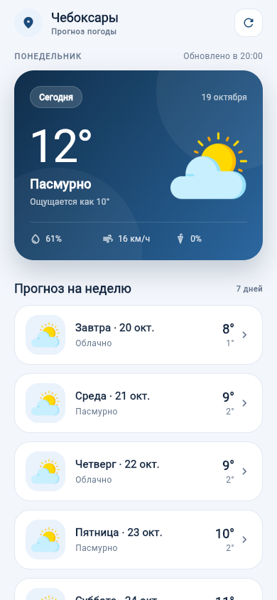
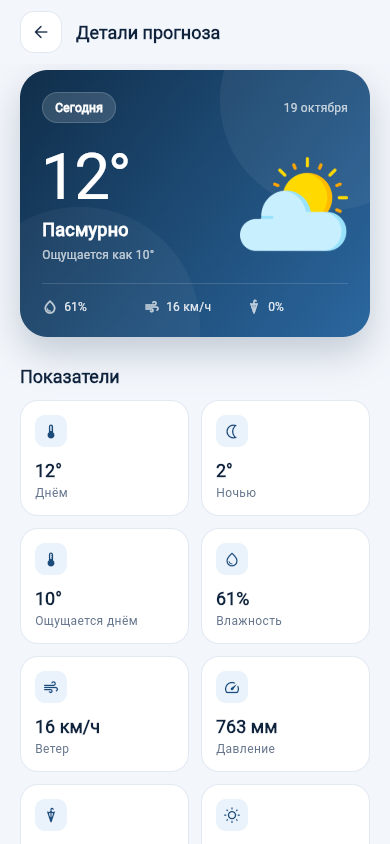

# Погода — Чебоксары

Кроссплатформенное приложение прогноза погоды на Flutter. Проект выполнен в рамках
курса «Кроссплатформенные средства разработки»: реализованы лабораторные работы
№1–5 (первый семестр).

**Предметная область:** прогноз погоды.
**Внешний API:** [Open-Meteo](https://open-meteo.com/) — открытый API без ключа.
**Точка прогноза:** Чебоксары (56.13, 47.25).

| Первый экран | Второй экран |
| --- | --- |
|  |  |

## Возможности

- прогноз на 7 дней списком на первом экране;
- подробный экран выбранного дня: температура, ощущения, влажность, ветер,
  давление, осадки, УФ-индекс, восход и закат;
- почасовой прогноз на 24 часа;
- переход на второй экран по идентификатору дня (дата в формате ISO);
- загрузка данных через `Dio`, разбор ответа Open-Meteo и модели с
  `json_serializable`;
- управление состоянием по архитектуре BLoC (`HomeBloc`, `DetailsBloc`);
- pull-to-refresh на обоих экранах;
- понятные состояния загрузки и ошибок с повторным запросом;
- адаптивная минималистичная вёрстка: карточки, сетка показателей и
  горизонтальная лента почасового прогноза;
- логирование HTTP-запросов, маршрутов и состояний блоков в `talker`.

## Используемые технологии

| Библиотека | Назначение |
| --- | --- |
| `go_router` | навигация и маршрутизация |
| `get_it` | внедрение зависимостей (DI) |
| `dio` | HTTP-клиент для запросов к API |
| `flutter_bloc`, `equatable` | управление состоянием |
| `json_annotation`, `json_serializable`, `build_runner` | модели и генерация сериализации |
| `talker`, `talker_flutter`, `talker_dio_logger`, `talker_bloc_logger` | логирование |

Firebase и работы №6–8 относятся ко второму семестру и в этой версии не
подключаются.

## Архитектура

Приложение разделено на слой представления (`lib/app`) и слой данных (`lib/data`).
Связь между ними обеспечивают репозитории и блоки, зарегистрированные в
`lib/di/di.dart`.

```
lib/
├── app/
│   ├── extensions/             # вспомогательные расширения
│   ├── features/
│   │   ├── home/               # первый экран (список дней) + HomeBloc
│   │   └── details/            # второй экран (подробности) + DetailsBloc
│   ├── router/                 # маршруты go_router
│   ├── theme/                  # палитра и тема приложения
│   ├── widgets/                # переиспользуемые карточки и состояния
│   └── app.dart                # экспорт слоя представления
├── data/
│   ├── dio/                    # настройка HTTP-клиента
│   ├── endpoints.dart          # конечные точки API
│   └── forecast/               # модели, DTO, репозиторий прогноза
├── di/di.dart                  # регистрация зависимостей
├── main.dart                   # точка входа
└── kukirmash_weather_app.dart  # корневой виджет приложения
```

### Запросы к API

| Запрос | Назначение | Параметры |
| --- | --- | --- |
| Список элементов | прогноз на 7 дней | `daily=...&forecast_days=7` |
| Элемент по id | подробности одного дня | `daily=...&hourly=...&start_date=YYYY-MM-DD&end_date=YYYY-MM-DD` |

Идентификатором дня служит дата `YYYY-MM-DD`. Ответ Open-Meteo приходит
«колонками» — параллельными массивами, — поэтому `ForecastResponse` склеивает их
в список моделей `DailyForecast` и `HourlyForecast`.

## Запуск

```bash
cd kukirmash_weather_app
flutter pub get

# генерация кода сериализации (файлы .g.dart уже есть в репозитории)
dart run build_runner build

flutter run              # текущая платформа
flutter run -d linux     # Linux
flutter run -d chrome    # Web
```

Проверка качества:

```bash
flutter analyze
flutter test
```

## Соответствие лабораторным работам

| Работа | Что реализовано |
| --- | --- |
| №0 | введение, выбор предметной области и API |
| №1 | создание и запуск Flutter-проекта |
| №2 | первый экран, тема, DI, навигация, логгер |
| №3 | второй экран с детальной информацией и переход на него |
| №4 | Dio, модели, репозиторий и `HomeBloc` первого экрана |
| №5 | запрос подробностей дня по id и `DetailsBloc` второго экрана |

Отчёты по работам находятся в папке [`docs/reports/`](docs/reports/README.md)
в форматах PDF и DOCX. Исходный пример оформления отчёта за лабораторную №2
сохранён отдельно в `docs/отчет лаб2.pdf`.

## Особенности платформ

- Android: разрешение `INTERNET` добавлено в основной манифест, поэтому запросы
  работают и в release-сборке.
- macOS: в entitlements включён сетевой клиент.
- Web: приложение собирается и работает без дополнительных настроек; Open-Meteo
  поддерживает CORS.
